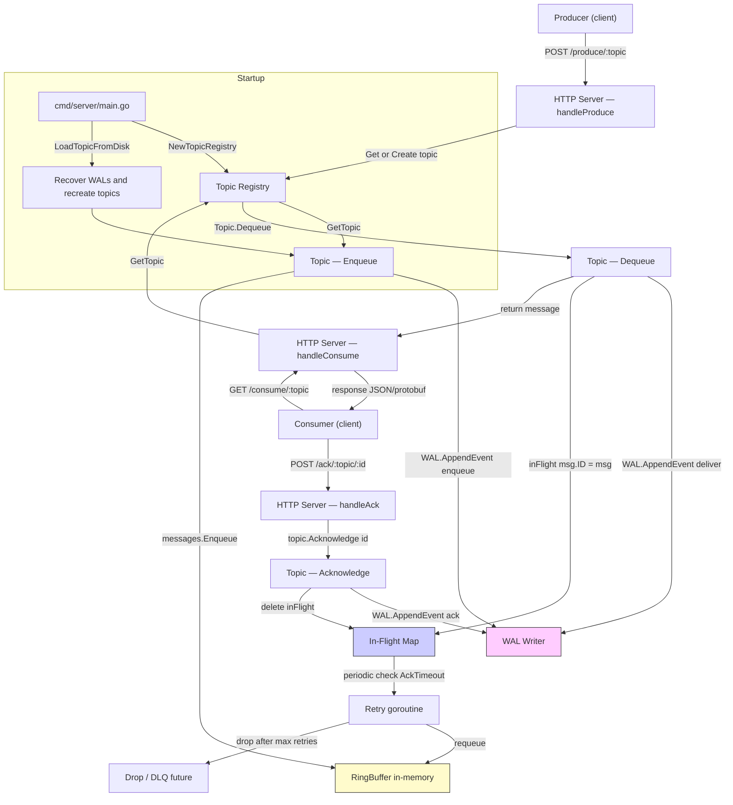

# go-queue — FLOW

This document explains the runtime flow of go-queue (how components interact and where data moves). The diagrams are simplified for easy understanding. For implementation details see the linked files in the repository (repository-relative paths are used so the file can be published).

Key components

- Producer: External client that calls HTTP endpoints to produce messages.
- HTTP Server: Receives produce/consume/ack requests. See [internal/http/httpserver.go](internal/http/httpserver.go).
- Topic Registry: Holds named topics and lifecycle. See [internal/queue/registry.go](internal/queue/registry.go).
- Topic: Per-topic queue with in-memory ring buffer, in-flight tracking, WAL, and retry logic. See [internal/queue/topic.go](internal/queue/topic.go).
- WAL (Write-Ahead Log): Durable event log writer (append-only, batched writer). See [internal/queue/persistence.go](internal/queue/persistence.go).
- RingBuffer: In-memory circular buffer implementation used for topic messages. See [internal/ringbuffer/ringbuffer.go](internal/ringbuffer/ringbuffer.go).
- Serializer: Protobuf/JSON adapters used for request/response encoding. See [internal/serialize/marshal.go](internal/serialize/marshal.go).
- Entrypoint: Starts registry, recovers topics from disk, then starts HTTP server. See [cmd/server/main.go](cmd/server/main.go).

Mermaid flow diagram

High-level flow (summary)

Producer -> POST /produce/:topic -> HTTP Server -> Registry -> Topic.Enqueue()

1. Enqueue: create Message with ID, WAL.AppendEvent("enqueue"), ringbuffer.Enqueue
2. Consumer polls: GET /consume/:topic -> HTTP Server -> Topic.Dequeue()
3. Dequeue: ringbuffer.Dequeue -> WAL.AppendEvent("deliver") -> add to inFlight -> HTTP returns message
4. Consumer ACKs: /ack/:topic/:id -> Topic.Acknowledge -> WAL.AppendEvent("ack") -> remove inFlight
5. If ACK not received within AckTimeout, background retry goroutine requeues message (increments retries)
6. On server restart, WALs are replayed to reconstruct in-memory queue + in-flight state

Notes / Important interactions

- WAL is append-only and written by a background goroutine. Topic.Enqueue and Topic.Acknowledge push LogEntry into WAL's channel. The WAL writer batches for performance.
- The system guarantees at-least-once delivery via retries + persistence; duplicates may occur if a consumer does not ACK before a crash or network failure.
- The ring buffer is the primary in-memory storage for queued (not-delivered) messages; in-flight messages live in a separate map so they are protected from being re-delivered until timed out or ACKed.
- Protobuf support: requests/responses may be encoded/decoded as protobuf (see internal/serialize).

Relevant files (quick links, repository-relative)

- [cmd/server/main.go](cmd/server/main.go)
- [internal/http/httpserver.go](internal/http/httpserver.go)
- [internal/queue/registry.go](internal/queue/registry.go)
- [internal/queue/topic.go](internal/queue/topic.go)
- [internal/queue/persistence.go](internal/queue/persistence.go)
- [internal/ringbuffer/ringbuffer.go](internal/ringbuffer/ringbuffer.go)
- [internal/serialize/marshal.go](internal/serialize/marshal.go)
